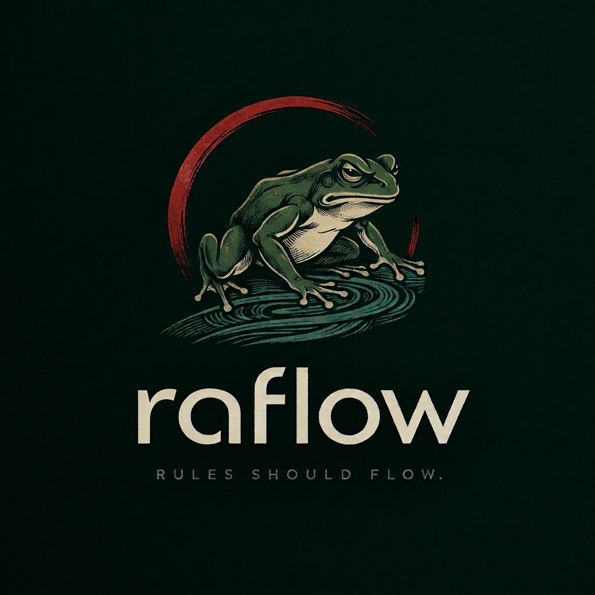
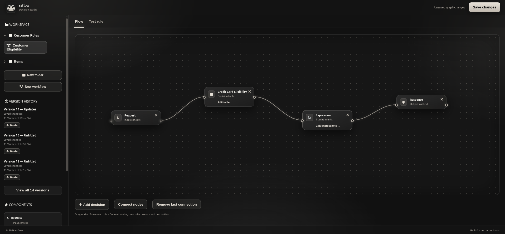
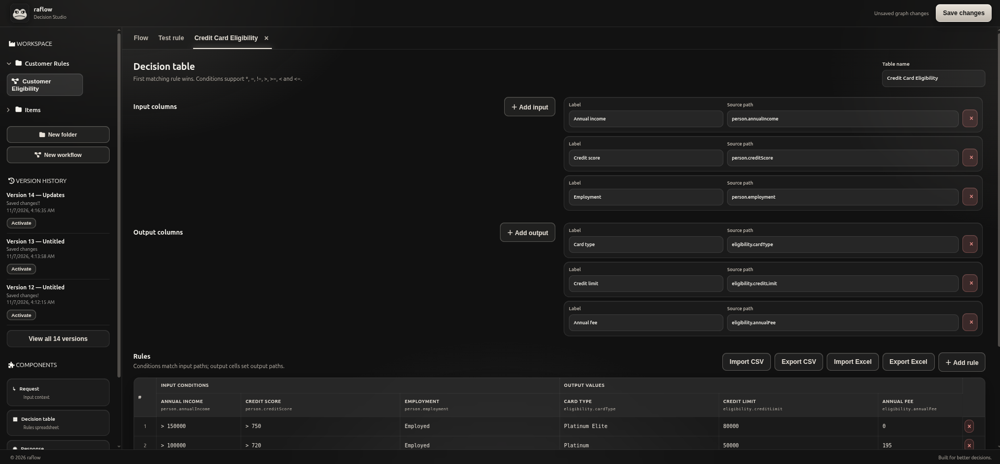
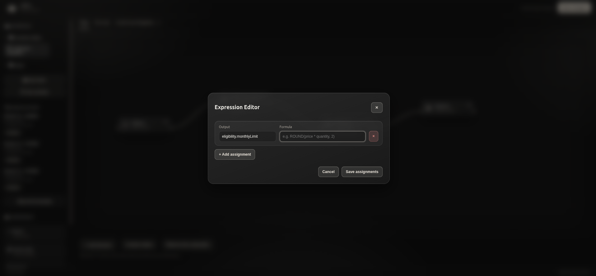
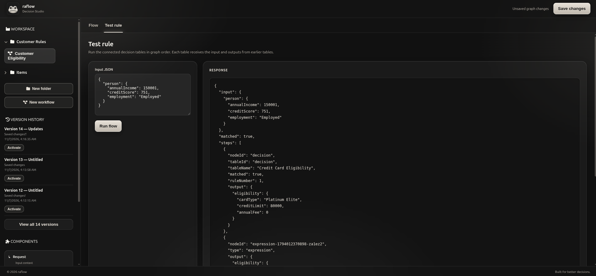
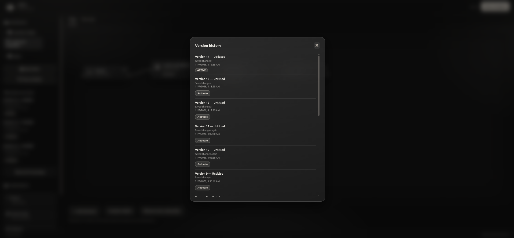

# raflow

<p align="center">
  
</p>

<p align="center">
  <strong>A visual decision engine for .NET 10</strong><br>
  Define rules. Compose decisions. Keep business logic flowing.
</p>

<p align="center">
  
  
  
</p>

---

**raflow** is an open-source decision engine and visual rule-authoring environment for .NET.

It provides a dedicated place to define business rules, evaluate decisions, compose logic and manage changes to decision behavior.

Instead of scattering business logic across services, controllers and conditional statements, raflow aims to make decisions explicit, understandable and independently maintainable.

**Rules should flow.**

## ✦ Why raflow?

Business rules have a habit of spreading everywhere.

They become embedded in services, duplicated across endpoints and tangled inside conditional statements. As requirements evolve, understanding the impact of a change becomes increasingly difficult.

raflow aims to give those rules a home.

Its goal is to make business decisions easier to:

- **Define** using visual decision tables.
- **Compose** using connected decision components.
- **Calculate** using expressions.
- **Test** using sample inputs.
- **Version** as business requirements change.
- **Execute** through an HTTP API.

raflow is being built as a decision engine first, with a developer-friendly platform around it.

## ◈ Features

The following capabilities are currently implemented:

### Visual rule editor

Design decision logic using a visual graph editor.

<p align="center">
  
</p>

Available components:

| Component      | Purpose                                        |
| -------------- | ---------------------------------------------- |
| Request        | Provides the input context                     |
| Decision table | Evaluates business rules                       |
| Expression     | Performs calculations and assignments          |
| Response       | Maps workflow data into the final API response |

The Response component uses the Output schema as its source of truth. It generates mappings for schema fields and allows developers to select which workflow context paths provide their values.

### Decision tables

Define business rules using a spreadsheet-like editor.

<p align="center">
  
</p>

- Define conditions and corresponding outputs.
- Organize business logic into readable rules.
- Import and export decision tables using CSV and Excel.
- Use expressions in supported output values.
- Configure how matching rules are evaluated using hit policies.
- Assign priorities to rules when using priority-based evaluation.
- Use a variety of condition operators to define rule matching.
- Combine conditions using AND/OR condition groups.

**Supported hit policies**

| Policy     | Behaviour                                                                                                     |
| ---------- | ------------------------------------------------------------------------------------------------------------- |
| `FIRST`    | Returns the first matching rule in table order.                                                               |
| `UNIQUE`   | Allows at most one matching rule. Multiple matches produce an ambiguity error.                                |
| `PRIORITY` | Returns the matching rule with the highest priority. Ties at the highest priority produce an ambiguity error. |
| `COLLECT`  | Returns the outputs of all matching rules as an array, preserving table order.                                |

**Supported condition operators**

| Operator       | Example                  | Behaviour                                                |
| -------------- | ------------------------ | -------------------------------------------------------- |
| `=`            | `= 18`                   | Equal to                                                 |
| `!=`           | `!= 18`                  | Not equal to                                             |
| `>`            | `> 18`                   | Greater than                                             |
| `>=`           | `>= 18`                  | Greater than or equal to                                 |
| `<`            | `< 18`                   | Less than                                                |
| `<=`           | `<= 18`                  | Less than or equal to                                    |
| `IN`           | `IN ("GR", "DE")`        | Matches any listed value                                 |
| `NOT IN`       | `NOT IN ("GR", "DE")`    | Matches none of the listed values                        |
| `CONTAINS`     | `CONTAINS "Premium"`     | Checks whether text or an array contains a value         |
| `NOT CONTAINS` | `NOT CONTAINS "Blocked"` | Checks whether text or an array does not contain a value |
| `IS NULL`      | `IS NULL`                | Matches missing or null inputs                           |
| `IS NOT NULL`  | `IS NOT NULL`            | Matches present, non-null inputs                         |

Text comparisons are case-insensitive. Numeric comparisons use decimal values.

Priority values are non-negative integers. Higher values represent higher priority, and the default priority is `0`.

When no rules match, `COLLECT` returns an empty array. The other policies return an unmatched result.

**Supported condition grouping**

Conditions can be organized into multiple groups within a single rule.

- Conditions inside a group can use `AND` or `OR`.
- Multiple groups within a rule are combined using `OR`.
- A rule matches when at least one condition group matches.

For example:

```text
Group 1: Model = "Model A" AND Color = "Black"
OR
Group 2: Model = "Model A" AND Color = "Red"
```

This allows a single rule to represent multiple alternative combinations of conditions while sharing the same output.

### Expressions

Perform calculations and assignments as part of a decision flow.

Currently supported mathematical functions include:

`ABS`, `ROUND`, `SUM`, `MIN`, `MAX`, `AVERAGE`, `POWER`, `SQRT`, `MOD`, `CEILING`.

<p align="center">
  
</p>

### Data schemas

Define the structure of incoming data and final workflow responses using dedicated Input and Output schemas.

- Define fields using String, Number, Integer, Boolean, Object and Array types.
- Create nested object properties and arrays of objects.
- Mark fields as required or optional.
- Add descriptions to schema fields.
- Maintain separate Input and Output schemas for each workflow.
- Include schemas in workflow version snapshots.

Input schemas validate incoming API payloads before execution. Output schemas validate the final response produced by the Response component.

### Flow testing

Test connected decision components using JSON input and inspect the resulting response.

- Validate incoming data against the workflow's Input schema.
- Execute connected decision and expression components.
- Map selected workflow values into the final response.
- Validate the final response against the Output schema.
- Inspect evaluation results and errors through the testing interface.

<p align="center">
  
</p>

### Version history

Go through all the available versions of the corresponding workflow and set as active the one that matches your business needs.

<p align="center">
  
</p>

### Flow testing

Test connected decision components using JSON input and inspect the resulting response.

<p align="center">
  
</p>

---

## ✦ The idea

### Workflow management and versioning

- Organize workflows into folders.
- Persist workflows using SQLite.
- Save workflow versions.
- Inspect version history.
- Activate a specific version.
- Load the active workflow for editing and execution.

### HTTP API

Execute a workflow through the API using its active version.

Current evaluation endpoint:

```http
POST /api/workflows/{id}/evaluate
```

This allows applications to consume decision results without relying on the visual editor.

## ⚙️ Technology

| Area          | Technology                  |
| ------------- | --------------------------- |
| Runtime       | .NET 10                     |
| Language      | C#                          |
| Web framework | ASP.NET Core MVC            |
| Persistence   | SQLite                      |
| Frontend      | JavaScript, HTML, CSS       |
| API           | ASP.NET Core HTTP endpoints |

## 🚀 Getting started

raflow is currently in early development and is not yet distributed as a NuGet package.

### Prerequisites

- .NET 10 SDK
- Git

### Run locally

Clone the repository:

```bash
git clone https://github.com/raf-init/raflow.git
cd raflow
```

Restore dependencies:

```bash
dotnet restore
```

Run the application:

```bash
dotnet run
```

Open the local URL displayed by the application.

The application initializes its local SQLite-backed workspace when it starts.

## 🧭 Roadmap

raflow is actively evolving. The roadmap reflects the intended direction, not a promise that every feature is already available.

### 1. Decision engine

- [x] Visual decision editor
- [x] Decision table evaluation
- [x] Expression components
- [x] Connected decision execution
- [x] Expand decision table condition operators
- [x] Add AND/OR condition groups
- [x] Introduce rule priorities and hit policies

### 2. Data transformation

- [ ] Introduce a dedicated Transform component
- [ ] Visual field mapping
- [ ] Custom output object construction
- [ ] JavaScript-based transformations in a sandboxed environment

### 3. Developer experience

- [x] Workflow testing
- [x] Workflow versioning
- [x] HTTP evaluation endpoint
- [ ] Execution debugger
- [ ] Rule evaluation traces
- [ ] Advanced validation and error reporting
- [ ] Reusable decision definitions

### 4. Platform capabilities

- [x] Data schema editor
- [ ] Version comparison
- [ ] API documentation
- [ ] Decision analytics
- [ ] Conditional routing where useful

## 🏗️ Design principles

| Principle            | Philosophy                                                                 |
| -------------------- | -------------------------------------------------------------------------- |
| Clarity              | Business rules should be easy to understand.                               |
| Composition          | Small decision components should work together.                            |
| Separation           | Decision logic should not be scattered throughout applications.            |
| Predictability       | The same input and active rule version should produce predictable results. |
| Extensibility        | The engine should grow without becoming unnecessarily complex.             |
| Developer experience | Good abstractions should make development simpler, not more mysterious.    |

## 🔒 Project status

raflow is an early-stage open-source project under active development.

The current implementation is intended for local development and experimentation. It is not yet production-ready. In particular, the current API does not include authentication, so do not expose it publicly without adding appropriate security controls.

The API, rule model and execution capabilities may evolve as the project develops.

## 🤝 Contributing

Ideas, feedback, bug reports and contributions are welcome.

If you're interested in decision engines, business rules or developer tooling, feel free to explore the project and join the discussion.

## 📜 License

A license has not yet been selected. Please check back for updates before using or redistributing the project.

---

<p align="center">
  <sub>Crafted with care for developers who value clarity.</sub><br>
  <strong>raflow</strong> · Let your rules flow.
</p>
