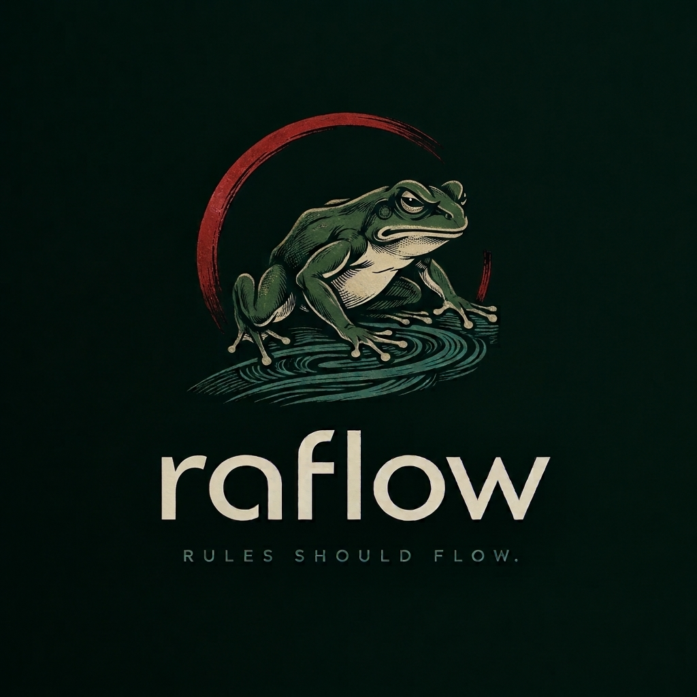

  

  <strong>A modern rules engine for .NET 10</strong>
   
  Rules should flow.

# raflow

### Rules should flow.

**raflow** is an open-source rules engine for .NET 10, focused on making business logic expressive, composable, and easier to maintain.

Build decisions from rules. Compose logic into flows. Keep your business logic where it belongs.

  
  

---

## ✦ The idea

Business rules have a habit of spreading everywhere.

They end up buried in services, duplicated across endpoints, and tangled inside conditional statements.

**raflow aims to give those rules a home.**

A dedicated place to define decision logic, compose behavior, and evolve business requirements without turning your application into a maze of `if` statements.

## ◈ Design principles

| Principle                | Philosophy                                                          |
| ------------------------ | ------------------------------------------------------------------- |
| **Clarity**              | Business rules should be easy to understand.                        |
| **Composition**          | Small rules should be capable of working together.                  |
| **Separation**           | Decision logic should not be scattered throughout your application. |
| **Extensibility**        | The engine should be designed to grow with your needs.              |
| **Developer experience** | Good abstractions should make code simpler, not more mysterious.    |

## ⚙️ Built for the .NET ecosystem

- **Runtime:** .NET 10
- **Language:** C#
- **Approach:** Explicit, maintainable business logic
- **Philosophy:** Small pieces. Composable rules. Clear decisions.

## 🚀 Getting started

raflow is currently in early development.

Installation instructions and a working quick-start example will be added when the initial API and package are ready.

## 🧭 Roadmap

- [ ] Define the core rule model
- [ ] Implement rule evaluation
- [ ] Design rule composition and execution flows
- [ ] Add unit tests and edge-case coverage
- [ ] Publish usage examples and documentation
- [ ] Prepare the first NuGet release

## 🤝 Contributing

Great open-source projects are built in the open.

Ideas, feedback, issues, and contributions are welcome as the project takes shape. Check the repository for current development plans before opening a pull request.

## 📜 License

The project's license will be specified here once selected.

---

  Crafted with care for developers who value clarity.
   
  <strong>Raflow</strong> · Let your rules flow.

